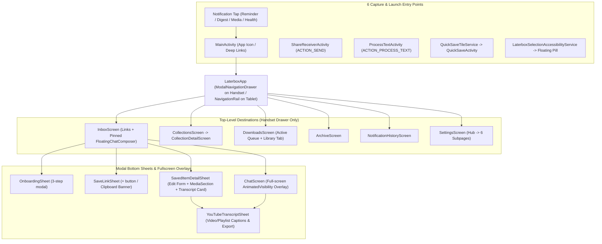

# 01 — Comprehensive Product Audit (Phases 1 & 2)

> **Historical Baseline Note**: This audit reflects the pre-overhaul codebase snapshot prior to the `v1.0.46`–`v1.0.48` overhaul passes. Items such as the handset bottom navigation bar (`LaterboxBottomBar`), in-app article reader (`ArticleReaderContent` unified inside `SavedItemDetailSheet`), contextual notification permission priming, offline Smart Digest copy fallback, and interactive onboarding have since been implemented on `main`. Always verify claims against the live codebase.

## Phase 1: Understanding LaterBox as Implemented

### 1.1 Technology Stack & Architecture Overview

- **Platform & SDKs**: Native Android application written in Kotlin (`2.0.21`), `minSdk = 26` (Android 8.0), `targetSdk = 35` (Android 15), `compileSdk = 35` ([`app/build.gradle.kts`](file:///home/antigravity/Adetisola/Laterbox/app/build.gradle.kts#L24-L32)).
- **UI Framework**: 100% Jetpack Compose with Material 3 (`composeBom = 2024.10.01`), custom design tokens ([`Color.kt`](file:///home/antigravity/Adetisola/Laterbox/app/src/main/java/com/laterbox/app/ui/theme/Color.kt), [`Type.kt`](file:///home/antigravity/Adetisola/Laterbox/app/src/main/java/com/laterbox/app/ui/theme/Type.kt), [`Spacing.kt`](file:///home/antigravity/Adetisola/Laterbox/app/src/main/java/com/laterbox/app/ui/theme/Spacing.kt)), and adaptive window size class detection ([`MainActivity.kt`](file:///home/antigravity/Adetisola/Laterbox/app/src/main/java/com/laterbox/app/MainActivity.kt#L103)).
- **Dependency Injection**: Manual constructor injection via [`AppContainer`](file:///home/antigravity/Adetisola/Laterbox/app/src/main/java/com/laterbox/app/di/AppContainer.kt#L55-L273) and [`AppViewModelProvider.Factory`](file:///home/antigravity/Adetisola/Laterbox/app/src/main/java/com/laterbox/app/ui/AppViewModelProvider.kt).
- **Local Persistence**:
  - **Room Database (`v11`)**: [`LaterboxDatabase.kt`](file:///home/antigravity/Adetisola/Laterbox/app/src/main/java/com/laterbox/app/data/local/LaterboxDatabase.kt#L35-L49) with 10 entities: `SavedLinkEntity`, `CollectionEntity`, `LinkCollectionCrossRef`, `MediaInspectionEntity`, `DownloadTaskEntity`, `DownloadedAssetEntity`, `LinkMediaCrossRef`, `ChatConversationEntity`, `ChatMessageEntity`, and `NotificationHistoryEntity`, with explicit non-destructive migrations (`MIGRATION_1_2` through `MIGRATION_10_11`).
  - **Preferences DataStore**: [`UserPreferencesRepository.kt`](file:///home/antigravity/Adetisola/Laterbox/app/src/main/java/com/laterbox/app/data/preferences/UserPreferencesRepository.kt#L45-L94) storing theme, font scale, view mode, reminder schedules, Gemini API key, capture preferences, and update state.
- **Background Work & Scheduling**:
  - WorkManager (`2.9.1`) for [`MetadataSyncWorker`](file:///home/antigravity/Adetisola/Laterbox/app/src/main/java/com/laterbox/app/data/worker/MetadataSyncWorker.kt), [`MediaDownloadWorker`](file:///home/antigravity/Adetisola/Laterbox/app/src/main/java/com/laterbox/app/media/data/download/MediaDownloadWorker.kt), [`SmartReminderWorker`](file:///home/antigravity/Adetisola/Laterbox/app/src/main/java/com/laterbox/app/reminders/smart/SmartReminderWorker.kt), and [`YtDlpUpdateWorker`](file:///home/antigravity/Adetisola/Laterbox/app/src/main/java/com/laterbox/app/media/data/adapters/ytdlp/YtDlpUpdateWorker.kt).
  - AlarmManager + [`ReminderReceiver`](file:///home/antigravity/Adetisola/Laterbox/app/src/main/java/com/laterbox/app/reminders/ReminderReceiver.kt) + [`BootReceiver`](file:///home/antigravity/Adetisola/Laterbox/app/src/main/java/com/laterbox/app/reminders/BootReceiver.kt) for exact/inexact manual link reminders and smart schedule triggers.
- **On-Device Media & Transcript Engine**:
  - `youtubedl-android` (`0.18.1` — `library`, `ffmpeg`, `aria2c`) + bundled `libqjs.so` (QuickJS runtime) + [`WarmYtDlpServer`](file:///home/antigravity/Adetisola/Laterbox/app/src/main/java/com/laterbox/app/media/data/adapters/ytdlp/WarmYtDlpServer.kt) persistent Python process.
  - Platform-specialized adapters: [`YtDlpAdapter`](file:///home/antigravity/Adetisola/Laterbox/app/src/main/java/com/laterbox/app/media/data/adapters/ytdlp/YtDlpAdapter.kt), [`XMediaAdapter`](file:///home/antigravity/Adetisola/Laterbox/app/src/main/java/com/laterbox/app/media/data/adapters/x/XMediaAdapter.kt) (`FxEmbedClient` for X/Twitter), [`SpotifyMusicAdapter`](file:///home/antigravity/Adetisola/Laterbox/app/src/main/java/com/laterbox/app/media/data/adapters/spotify/SpotifyMusicAdapter.kt) (matching Spotify tracks to downloadable audio streams with ID3/M4A artwork tagging via `jaudiotagger`), [`TikTokUrlResolver`](file:///home/antigravity/Adetisola/Laterbox/app/src/main/java/com/laterbox/app/media/data/adapters/tiktok/TikTokUrlResolver.kt), and [`DirectUrlAdapter`](file:///home/antigravity/Adetisola/Laterbox/app/src/main/java/com/laterbox/app/media/data/adapters/direct/DirectUrlAdapter.kt).
  - In-app media playback via Media3 ExoPlayer (`1.4.1`) in [`MediaPlayerActivity`](file:///home/antigravity/Adetisola/Laterbox/app/src/main/java/com/laterbox/app/media/ui/player/MediaPlayerActivity.kt) and [`ImageViewerActivity`](file:///home/antigravity/Adetisola/Laterbox/app/src/main/java/com/laterbox/app/media/ui/viewer/ImageViewerActivity.kt).
  - [`YouTubeTranscriptExtractor`](file:///home/antigravity/Adetisola/Laterbox/app/src/main/java/com/laterbox/app/transcript/extractor/YouTubeTranscriptExtractor.kt) and [`TranscriptExportManager`](file:///home/antigravity/Adetisola/Laterbox/app/src/main/java/com/laterbox/app/transcript/export/TranscriptExportManager.kt) supporting single videos and playlists with Markdown (`.md`), Plain Text (`.txt`), and clickable-timestamp PDF (`.pdf`) exports.
- **AI & Voice Integration**:
  - [`GeminiClient`](file:///home/antigravity/Adetisola/Laterbox/app/src/main/java/com/laterbox/app/ai/GeminiClient.kt) supporting a 3-tier resolution strategy: (1) user-supplied Google AI Studio API key, (2) build-time `BuildConfig.EMBEDDED_GEMINI_API_KEY`, or (3) Firebase AI Logic SDK (`firebase-ai`).
  - [`LaterboxContextEngine`](file:///home/antigravity/Adetisola/Laterbox/app/src/main/java/com/laterbox/app/ai/LaterboxContextEngine.kt) and [`AssistantActionHandler`](file:///home/antigravity/Adetisola/Laterbox/app/src/main/java/com/laterbox/app/ai/AssistantActionHandler.kt) enabling grounded library Q&A and structured actions (open link, archive, delete, set reminder, inspect media, open transcripts, run diagnostics).
  - [`SpeechTranscriptionCoordinator`](file:///home/antigravity/Adetisola/Laterbox/app/src/main/java/com/laterbox/app/ai/speech/SpeechTranscriptionCoordinator.kt) for voice dictation.
- **Distribution & Self-Update**:
  - GitHub Releases update checker ([`GitHubUpdateChecker.kt`](file:///home/antigravity/Adetisola/Laterbox/app/src/main/java/com/laterbox/app/update/GitHubUpdateChecker.kt)) with ABI-specific APK matching and `bsdiff`/`bspatch` binary delta patching ([`BsPatch.kt`](file:///home/antigravity/Adetisola/Laterbox/app/src/main/java/com/laterbox/app/update/patch/BsPatch.kt)).

### 1.2 Screen & Navigation Map

---

## Phase 2: Comprehensive Product Audit

### A. Product Strategy & Value Proposition

1. **Severe Positioning Disconnect ("Calm Minimalist Reading List" vs. "Power-User Media, Transcript & AI Vault")**:
   - **Evidence**: [`README.md`](file:///home/antigravity/Adetisola/Laterbox/README.md#L1-L29) and [`OnboardingSheet.kt`](file:///home/antigravity/Adetisola/Laterbox/app/src/main/java/com/laterbox/app/ui/onboarding/OnboardingSheet.kt#L29-L36) pitch LaterBox as *"Your calm, distraction-free reading library... No notification badges."*
   - **Reality**: LaterBox is actually a powerhouse local-first utility that:
     - Captures links from 5 system surfaces (Share sheet, text selection toolbar, floating accessibility pill, Quick Settings tile, clipboard banner).
     - Downloads videos, audio, and images from YouTube, X/Twitter, TikTok, and Spotify (matching Spotify tracks to downloadable audio with embedded album art and ID3 tags).
     - Extracts verbatim YouTube transcripts for single videos and entire playlists and exports them to PDF/Markdown/TXT.
     - Embeds a context-aware Gemini AI assistant capable of executing actions across the library.
     - Runs 4 distinct notification channels with an unread badge count in the top bar.
   - **Why It Matters**: Users who install expecting a minimalist Instapaper/Pocket clone are startled by a `100+ MB` binary (`youtubedl-android` + `FFmpeg` + `QuickJS`), a persistent AI chat composer at the bottom of their reading list, and NO in-app article reader. Conversely, power users who would love a private, local-first link + media + transcript vault never discover those capabilities during onboarding or on the main screen because they are buried 3–4 taps deep inside [`SavedItemDetailSheet.kt`](file:///home/antigravity/Adetisola/Laterbox/app/src/main/java/com/laterbox/app/ui/sheets/SavedItemDetailSheet.kt#L387-L441).

2. **Missing Core Capability for a "Reading Library": No In-App Article Reader**:
   - **Evidence**: When a user saves a web article and taps `"View ↗"`, [`BrowserLauncher.kt`](file:///home/antigravity/Adetisola/Laterbox/app/src/main/java/com/laterbox/app/ui/util/BrowserLauncher.kt) opens a Chrome Custom Tab or external browser. If the user is offline (despite `README.md` promising *"Offline Access — Browse your entire library, read personal notes, and search links with zero connectivity"*), they can only see the 2-line OpenGraph description—the article body itself is never cached or rendered in a clean reader view.

---

### B. UI & Visual Design

1. **Strengths in Visual Craft**:
   - The color palette in [`Color.kt`](file:///home/antigravity/Adetisola/Laterbox/app/src/main/java/com/laterbox/app/ui/theme/Color.kt#L9-L90) (Warm Alabaster `#FAF8F5` in light mode, Deep Obsidian `#0B0F17` in dark mode, Crimson Rose `#E11D48` / `#FB7185` accent) and editorial typography in [`Type.kt`](file:///home/antigravity/Adetisola/Laterbox/app/src/main/java/com/laterbox/app/ui/theme/Type.kt#L29-L115) (`SourceSerif4` for display/card titles, `PlusJakartaSans` for UI/body, `JetBrainsMono` for metadata/code) are genuinely distinctive, warm, and well-tokenized.
   - [`SavedLinkCard.kt`](file:///home/antigravity/Adetisola/Laterbox/app/src/main/java/com/laterbox/app/ui/components/SavedLinkCard.kt) handles 3 view modes (`CARD`, `COMPACT`, and an unexposed `EDITORIAL` mode), swipe gestures (left to archive, right to toggle read), and platform-tinted badges cleanly.

2. **Visual Hierarchy & Screen Composition Issues**:
   - **Inbox Bottom Crowding**: On [`InboxScreen.kt`](file:///home/antigravity/Adetisola/Laterbox/app/src/main/java/com/laterbox/app/ui/inbox/InboxScreen.kt#L412-L426), the bottom `110dp+` of the screen is permanently covered by a vertical gradient haze and [`FloatingChatComposer.kt`](file:///home/antigravity/Adetisola/Laterbox/app/src/main/java/com/laterbox/app/ui/components/FloatingChatComposer.kt). This visually turns the primary Inbox into a "chat app with links in the background" rather than a personal library.
   - **`SavedItemDetailSheet` Visual Inversion**: Opening [`SavedItemDetailSheet.kt`](file:///home/antigravity/Adetisola/Laterbox/app/src/main/java/com/laterbox/app/ui/sheets/SavedItemDetailSheet.kt#L172-L263) immediately presents two large editable `OutlinedTextField` boxes (`"Title"` and `"Personal Note"` with a `0/500` character counter) right under the preview header. This makes every link tap look like a database record editor instead of a content consumption view.
   - **Dead `InboxViewMode.EDITORIAL` Token**: [`UserPreferencesRepository.kt`](file:///home/antigravity/Adetisola/Laterbox/app/src/main/java/com/laterbox/app/data/preferences/UserPreferencesRepository.kt#L28-L32) defines `CARD`, `COMPACT`, and `EDITORIAL`, and [`SavedLinkCard.kt`](file:///home/antigravity/Adetisola/Laterbox/app/src/main/java/com/laterbox/app/ui/components/SavedLinkCard.kt#L139) implements `InboxViewMode.EDITORIAL`, but [`InboxViewModel.kt`](file:///home/antigravity/Adetisola/Laterbox/app/src/main/java/com/laterbox/app/ui/inbox/InboxViewModel.kt#L194-L202) only toggles between `CARD` and `COMPACT`.
   - **Multi-Collection Badge Truncation Bug**: While [`SavedLink.kt`](file:///home/antigravity/Adetisola/Laterbox/app/src/main/java/com/laterbox/app/domain/model/SavedLink.kt) supports `collectionNames: List<String>`, [`SavedLinkCard.kt`](file:///home/antigravity/Adetisola/Laterbox/app/src/main/java/com/laterbox/app/ui/components/SavedLinkCard.kt#L333-L340) only renders `link.collectionName` (the first collection) and silently hides any additional collections assigned to the link (`+N` indicator is missing).

---

### C. UX & Information Architecture

1. **Orphaned Bottom Navigation Bar & Hamburger Drawer Trap**:
   - **Evidence**: [`LaterboxBottomBar.kt`](file:///home/antigravity/Adetisola/Laterbox/app/src/main/java/com/laterbox/app/ui/components/LaterboxBottomBar.kt#L59) is a complete, well-designed floating pill bottom navigation bar for `INBOX`, `COLLECTIONS`, `DOWNLOADS`, and `ARCHIVE`—**yet it has zero call sites in the entire codebase**.
   - Instead, [`LaterboxNavGraph.kt`](file:///home/antigravity/Adetisola/Laterbox/app/src/main/java/com/laterbox/app/ui/navigation/LaterboxNavGraph.kt#L305-L334) uses a `ModalNavigationDrawer` on handsets. Every switch between Inbox, Collections, Downloads, and Archive requires reaching to the top-left corner (`40dp` icon button) or swiping from the left screen edge (which conflicts with Android's system back gesture and `SavedLinkCard`'s horizontal swipe-to-read gesture!).

2. **Confusing Card Tap vs. `"View ↗"` Action Split**:
   - **Evidence**: In [`InboxScreen.kt`](file:///home/antigravity/Adetisola/Laterbox/app/src/main/java/com/laterbox/app/ui/inbox/InboxScreen.kt#L353-L361), tapping anywhere on a `SavedLinkCard` triggers `onLinkClick`, which opens `SavedItemDetailSheet` (the edit/detail sheet) and does **not** mark the link as read (`autoMarkAsRead` only runs on `onQuickOpenClick`, which is bound to the small `"View ↗"` chip in the card footer).
   - Users naturally tap an article or video card expecting to read/watch it, only to land on an edit form.

3. **Missing Inbox Triage Filters (Unread / Scheduled / Media Ready)**:
   - **Evidence**: [`InboxScreen.kt`](file:///home/antigravity/Adetisola/Laterbox/app/src/main/java/com/laterbox/app/ui/inbox/InboxScreen.kt#L230-L287) provides collection filter chips (`All`, plus user collections) and a sort menu (`Newest`, `Oldest`, `Domain A-Z`, `Unread First`), **but no quick filter for status or content type**:
     - Users cannot filter to **Unread Only** (once read items accumulate in the Inbox, they stay mixed in unless manually archived).
     - Users cannot filter by **Media / Offline Ready** (`mediaReadyLinkIds` is already computed in [`InboxUiState.kt`](file:///home/antigravity/Adetisola/Laterbox/app/src/main/java/com/laterbox/app/ui/inbox/InboxUiState.kt#L34)!).
     - Users cannot filter by **Reminders** or **Content Type** (Video, Article, Music, Social).

4. **Inconsistent Search Across Inbox vs. Archive vs. AI Assistant**:
   - **Evidence**:
     - [`SavedLinkDao.searchLinks()`](file:///home/antigravity/Adetisola/Laterbox/app/src/main/java/com/laterbox/app/data/local/dao/SavedLinkDao.kt#L55-L64) (used by Inbox UI search) searches `title`, `domain`, `original_url`, and `personal_note`, **but omits `description` and `site_name`**.
     - [`SavedLinkDao.searchInboxLinksSnapshot()`](file:///home/antigravity/Adetisola/Laterbox/app/src/main/java/com/laterbox/app/data/local/dao/SavedLinkDao.kt#L73-L84) (used by the AI Assistant) **does** search `description`.
     - [`ArchiveViewModel.kt`](file:///home/antigravity/Adetisola/Laterbox/app/src/main/java/com/laterbox/app/ui/archive/ArchiveViewModel.kt#L31-L36) filters in-memory on `title`, `domain`, `description`, and `personalNote`, **but omits `originalUrl`**.

5. **`CollectionDetailScreen` Missing Card Actions & Media Readiness**:
   - **Evidence**: Comparing [`InboxScreen.kt`](file:///home/antigravity/Adetisola/Laterbox/app/src/main/java/com/laterbox/app/ui/inbox/InboxScreen.kt#L353-L362) with [`CollectionDetailScreen.kt`](file:///home/antigravity/Adetisola/Laterbox/app/src/main/java/com/laterbox/app/ui/collections/CollectionDetailScreen.kt#L126-L130): `CollectionDetailScreen` renders `SavedLinkCard` **without** `viewMode`, `hasDownloadedMedia`, `onArchiveSwipe`, or `onToggleReadSwipe`! Swiping a card inside a Collection does nothing, and the `"Media ready"` badge never appears inside Collections. The same omission exists in [`ArchiveScreen.kt`](file:///home/antigravity/Adetisola/Laterbox/app/src/main/java/com/laterbox/app/ui/archive/ArchiveScreen.kt#L128-L138).

---

### D. Onboarding & Activation

1. **Passive, High-Friction Onboarding Sheet**:
   - **Evidence**: [`OnboardingSheet.kt`](file:///home/antigravity/Adetisola/Laterbox/app/src/main/java/com/laterbox/app/ui/onboarding/OnboardingSheet.kt#L19-L43) presents 3 text slides:
     - Slide 1: *"Save from anywhere — Open Chrome, YouTube, X, or any app. Tap Share → Laterbox..."*
     - Slide 2: *"Your calm, distraction-free reading library — Everything stays organized in one quiet inbox. No notification badges, no clutter."*
     - Slide 3: *"Private by design. Yours forever. — Stored locally in an on-device SQLite database... Export or restore anytime as open JSON."*
   - **Problems**:
     1. When the user taps `"Get Started"` or `"Skip"`, they land on an empty screen saying `"Nothing saved. Yet."` ([`InboxScreen.kt`](file:///home/antigravity/Adetisola/Laterbox/app/src/main/java/com/laterbox/app/ui/inbox/InboxScreen.kt#L298-L311)).
     2. To experience any value, the user must leave LaterBox, open another app, find a URL, share it back, or manually type a URL.
     3. Onboarding never mentions LaterBox's standout capabilities (offline video/audio downloads, Spotify-to-audio matching, YouTube transcript PDF/Markdown export, or smart reminders).
     4. Slide 3 talks about *"SQLite database"* and *"open JSON"*—implementation jargon rather than user-facing benefit.

2. **Missing Notification Permission Priming (`POST_NOTIFICATIONS`)**:
   - **Evidence**: On Android 13+ (`TIRAMISU`), `POST_NOTIFICATIONS` is a runtime permission. A codebase-wide search confirms `ActivityResultContracts.RequestPermission()` for `POST_NOTIFICATIONS` is **only called inside [`MediaSection.kt`](file:///home/antigravity/Adetisola/Laterbox/app/src/main/java/com/laterbox/app/media/ui/linkdetail/MediaSection.kt#L105-L129)** when starting a media download.
   - It is **never requested**:
     - During onboarding
     - When a user schedules a manual reminder in [`SaveLinkForm.kt`](file:///home/antigravity/Adetisola/Laterbox/app/src/main/java/com/laterbox/app/ui/save/SaveLinkForm.kt#L254) or [`SavedItemDetailSheet.kt`](file:///home/antigravity/Adetisola/Laterbox/app/src/main/java/com/laterbox/app/ui/sheets/SavedItemDetailSheet.kt#L303)
     - When Smart Reminders are enabled by default in [`UserPreferences`](file:///home/antigravity/Adetisola/Laterbox/app/src/main/java/com/laterbox/app/data/preferences/UserPreferencesRepository.kt#L53)
   - **Impact**: If a user saves a link and taps `"Tonight 20:00"` to set a reminder, the UI shows `"Reminder set for..."`, the alarm fires at 20:00, [`NotificationHelper.showReminderNotification()`](file:///home/antigravity/Adetisola/Laterbox/app/src/main/java/com/laterbox/app/reminders/NotificationHelper.kt#L124-L132) sees `POST_NOTIFICATIONS != PERMISSION_GRANTED`, logs a warning, and drops the notification! The user's explicit reminder silently fails.

---

### E. Retention & Engagement

1. **Confirmed High-Severity Bug: Smart Digest Silently Fails Without Gemini API Key or When Offline**:
   - **Evidence**: Look at [`SmartReminderWorker.kt`](file:///home/antigravity/Adetisola/Laterbox/app/src/main/java/com/laterbox/app/reminders/smart/SmartReminderWorker.kt#L79-L122) and [`ReminderReceiver.kt`](file:///home/antigravity/Adetisola/Laterbox/app/src/main/java/com/laterbox/app/reminders/ReminderReceiver.kt#L139-L176):
     - Both call `SmartDigestEngine.generateDigestCopy(...)`.
     - If no Gemini API key is configured (`BuildConfig.EMBEDDED_GEMINI_API_KEY` is empty in standard builds unless injected from `local.properties`, and most users will not paste a Google AI Studio key), or if the device is offline/rate-limited, `generateDigestCopy` returns `AiCopyResult.Failure(AiFailure.NoApiKey / Offline)`.
     - Unlike manual reminders (which fall back to `PlainReminderCopy.forManual(link)` in [`ReminderReceiver.kt`](file:///home/antigravity/Adetisola/Laterbox/app/src/main/java/com/laterbox/app/reminders/ReminderReceiver.kt#L60-L66)), both `SmartReminderWorker` and `ReminderReceiver` (`ACTION_TRIGGER_SMART_SCHEDULE`) **treat `AiCopyResult.Failure` as a fatal delivery abort**, log `"AI reminder generation failed... Skip this slot quietly and schedule next occurrence"`, and **never post the notification**!
     - Irony: [`NotificationHelper.showSmartDigestNotification()`](file:///home/antigravity/Adetisola/Laterbox/app/src/main/java/com/laterbox/app/reminders/NotificationHelper.kt#L183-L204) *already has* non-AI fallback copy written (`"From your reading list"` / `"Worth revisiting when you have a moment: ${link.title}"`), and `NotificationHelper.showReminderNotification()` has warm personalized fallback copy (`"Hey $cleanName, worth a look when you're free"`), but they are never reached when `generateDigestCopy` returns `Failure`!
   - **Impact**: Smart Reminders (LaterBox's #1 retention mechanism, enabled by default for 20:30 daily) **never fire for any user without a working Gemini API key or active internet connection at 20:30**.

2. **Lack of Backlog Forgiveness & Resurfacing Ritual**:
   - Bookmarking apps suffer from "read-it-later guilt": users save 50+ links, feel overwhelmed by an undifferentiated list, and abandon the app.
   - Currently, `InboxScreen` shows a flat list with no distinction between "Saved today", "Ready to watch/listen offline", and "Gathering dust (30+ days old)". There is no lightweight "3-link quick triage" or "Archive old read links" action to keep the Inbox feeling fresh.

---

### F. Additional Product Areas

1. **Data Backup & Restore Completeness Gap**:
   - **Evidence**: [`BackupManager.kt`](file:///home/antigravity/Adetisola/Laterbox/app/src/main/java/com/laterbox/app/data/backup/BackupManager.kt#L32-L49) exports `originalUrl`, `normalizedUrl`, `title`, `description`, `siteName`, `domain`, `faviconUrl`, `previewImageUrl`, `contentType`, `personalNote`, `collectionNames`, `isRead`, `isArchived`, and `createdAt`.
   - **Missing from Backup**: `reminderAt`, `nudgeCount`, `lastNudgedAt`, `nudgeDismissed`, and `updatedAt` are **not serialized** in `BackupLink`! Restoring a JSON backup loses all scheduled reminders on saved links.

2. **Privacy, Permissions & User Trust**:
   - **Strengths**: Local-first storage, explicit per-conversation action permissions in [`ChatViewModel.kt`](file:///home/antigravity/Adetisola/Laterbox/app/src/main/java/com/laterbox/app/ui/chat/ChatViewModel.kt#L32-L46), secret redaction in [`GeminiClient.redactSecrets()`](file:///home/antigravity/Adetisola/Laterbox/app/src/main/java/com/laterbox/app/ai/GeminiClient.kt), and a dedicated [`AccessibilityOnboardingSheet.kt`](file:///home/antigravity/Adetisola/Laterbox/app/src/main/java/com/laterbox/app/ui/settings/AccessibilityOnboardingSheet.kt) explaining that the accessibility service only inspects selected URLs.
   - **Trust Friction**: [`LaterboxContextEngine.kt`](file:///home/antigravity/Adetisola/Laterbox/app/src/main/java/com/laterbox/app/ai/LaterboxContextEngine.kt#L144-L214) sends up to 10 saved links (titles, URLs, personal notes), 8 recent notifications, and 8 activity events to Google's Gemini API on every chat message—even if the user only says *"Hi"* or asks a general question. Furthermore, onboarding claims *"Every link, note, and collection is stored locally... with no cloud tracking"*, without clarifying that using the AI Assistant or AI Smart Digests transmits link titles/notes to Google AI Studio.

3. **Performance, Startup Time, Memory & Battery**:
   - **Cold Startup Herd in [`LaterboxApplication.onCreate()`](file:///home/antigravity/Adetisola/Laterbox/app/src/main/java/com/laterbox/app/LaterboxApplication.kt#L35-L89)**:
     - Immediately launches coroutines and workers on cold start:
       1. `ytDlpRuntimeManager.ensureYtDlpInitialized()` (heavy native extraction/python check)
       2. `ytDlpRuntimeManager.ensureFfmpegInitialized()`
       3. `linkRepository.resetStuckFetchingLinks()`
       4. `MetadataSyncWorker.enqueue()`
       5. `SmartReminderCoordinator.sync()`
       6. `mediaRepository.recoverInterruptedTasks()`
       7. `mediaStorageManager.runOrphanSweep()` (walks filesystem + queries DB)
       8. `ApkInstallerHelper.cleanupOldUpdateApks()`
       9. `mediaRepository.reconcileInspections()` (also triggered again immediately in `onActivityStarted`!)
     - Note that `ShareReceiverActivity`, `QuickSaveActivity`, and `ProcessTextActivity` all run in the same application process—so sharing a link from Chrome triggers `LaterboxApplication.onCreate()` and spins up `yt-dlp`, `FFmpeg`, orphan file sweeps, and inspection reconciliation just to display a compact save sheet!
   - **Eager Creation of All 11 ViewModels in [`LaterboxNavGraph.kt`](file:///home/antigravity/Adetisola/Laterbox/app/src/main/java/com/laterbox/app/ui/navigation/LaterboxNavGraph.kt#L125-L135)**:
     - `LaterboxApp` instantiates `inboxViewModel`, `collectionsViewModel`, `collectionDetailViewModel`, `archiveViewModel`, `saveLinkViewModel`, `savedItemDetailViewModel`, `settingsViewModel`, `notificationHistoryViewModel`, `downloadsViewModel`, `chatViewModel`, and `youTubeTranscriptViewModel` at the top of `LaterboxApp()` and collects all their `StateFlow`s (`collectAsState()`) simultaneously on every frame.
   - **Unshared `OkHttpClient` Instances**:
     - [`AppContainer.kt`](file:///home/antigravity/Adetisola/Laterbox/app/src/main/java/com/laterbox/app/di/AppContainer.kt#L176-L195) instantiates 3 separate `OkHttpClient()` instances for `DirectUrlAdapter`, `FxEmbedClient`, and `SpotifyMetadataProvider`, plus additional instances in `HttpDownloader`, `GitHubUpdateChecker`, `YtDlpUpdater`, and `HttpURLConnection` in `GeminiClient`/`SmartDigestEngine`. Each `OkHttpClient` allocates its own `ConnectionPool` and `Dispatcher` executor threads.

4. **Accessibility & Touch Targets**:
   - **Touch Targets Below `48dp` Minimum**:
     - In [`SavedLinkCard.kt`](file:///home/antigravity/Adetisola/Laterbox/app/src/main/java/com/laterbox/app/ui/components/SavedLinkCard.kt#L379-L398), the `"View ↗"` quick-open pill has only `vertical = 4.dp` internal padding (~`24dp` total height), making the most important action on the card difficult to tap reliably.
     - In [`MediaSection.kt`](file:///home/antigravity/Adetisola/Laterbox/app/src/main/java/com/laterbox/app/media/ui/linkdetail/MediaSection.kt#L671-L687), the Export (`32.dp`) and Delete (`32.dp`) `IconButton`s and in `ActiveTaskRow` (`line 720`, `24.dp`) are well below the Android `48.dp` minimum touch target guideline.
   - **Horizontal Gesture Conflict**:
     - On handset screens, `ModalNavigationDrawer` intercepts left-to-right edge drags while `SavedLinkCard` uses `SwipeToDismissBox` for left-to-right ("Mark read") and right-to-left ("Archive") gestures.
