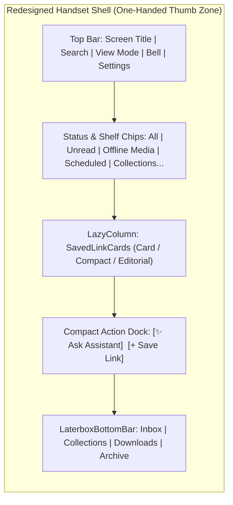
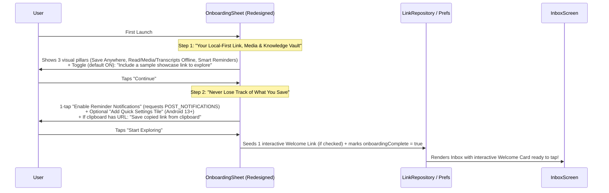

# 03 — Proposed Product Experience, UX & Onboarding Flows (Phases 4.3 & 4.4)

## 1. Proposed Information Architecture & Navigation Overhaul

### 1.1 Activating Bottom Navigation for One-Handed Ergonomics
Today, handset users can only navigate between `Inbox`, `Collections`, `Downloads`, and `Archive` via the top-left `ModalNavigationDrawer`, while [`LaterboxBottomBar.kt`](file:///home/antigravity/Adetisola/Laterbox/app/src/main/java/com/laterbox/app/ui/components/LaterboxBottomBar.kt#L59) sits unused.

In the overhauled experience:
- **Handset (`COMPACT` width)**:
  - **Bottom Navigation Bar ([`LaterboxBottomBar`](file:///home/antigravity/Adetisola/Laterbox/app/src/main/java/com/laterbox/app/ui/components/LaterboxBottomBar.kt#L59))**: Persistent across the 4 core library destinations:
    1. **Inbox** (Unread & active saved items)
    2. **Collections** (Curated topic shelves)
    3. **Downloads** (Offline video, audio, images & exported transcripts, with active download badge)
    4. **Archive** (Completed & stored items)
  - **Top Header Bar**:
    - Left: App title (`Laterbox`) or screen title (removing the mandatory top-left hamburger reach for primary tab switching).
    - Right: `Search`, `View Mode` (`Card` / `Compact` / `Editorial`), `Notifications` (with unread badge), and `Settings` gear icon (or drawer trigger for secondary utilities).
  - **Contextual Capture & Assistant Dock (Above Bottom Bar on Inbox)**:
    - Replaces the permanently expanded full-width `FloatingChatComposer` with a sleek, non-intrusive dual action pill:
      - **Left/Center Pill**: `✨ Ask Laterbox...` (tapping smoothly opens `ChatScreen` with keyboard or voice dictation ready).
      - **Right Primary Button**: `+ Save` (opens `SaveLinkSheet`).
- **Tablet / Foldable (`MEDIUM` / `EXPANDED` width)**:
  - Retains the existing `LaterboxNavigationRail` on the left edge.

---

## 2. Screen-Level UX Redesigns

### 2.1 `InboxScreen`: Smart Triage Filters & Backlog Relief
- **Unified Filter Bar**:
  - **Status/Type Quick Chips**:
    - `All`
    - `Unread (N)`
    - `Offline Ready` (filters by `mediaReadyLinkIds`)
    - `Scheduled` (links with active `reminderAt`)
    - `Videos` (`ContentType.VIDEO`)
  - **Collection Chips**: Follow immediately in the horizontal chip row (or secondary shelf selector).
- **One-Tap "Clear Read" Action**:
  - When the Inbox contains items already marked as read (`isRead == true`), a subtle chip/button `"Archive Read (N)"` lets the user sweep finished items into the Archive in one tap (with a 5-second `"Undo"` Snackbar).

### 2.2 `SavedLinkCard`: Clearer Action Hierarchy & Multi-Collection Badges
- **Multi-Collection Badge Fix**:
  - In [`SavedLinkCard.kt`](file:///home/antigravity/Adetisola/Laterbox/app/src/main/java/com/laterbox/app/ui/components/SavedLinkCard.kt#L333-L340), when `link.collectionNames.size > 1`, display `"${link.collectionNames.first()} +${link.collectionNames.size - 1}"` instead of silently hiding additional collections.
- **Touch Target & Primary Action Clarity**:
  - Increase the `"View ↗"` / `"Read"` quick-action pill touch target to `minHeight = 40.dp` (with `48.dp` hit slop) so users never mis-tap and open the detail sheet when trying to launch the link.
  - Add a user preference in `Settings → Reading & Behaviour`: **Default Card Tap Action**:
    - *Option A (Default)*: **Open Link Hub Sheet** (redesigned consumption-first `SavedItemDetailSheet`).
    - *Option B*: **Open In-App Reader / Media Player** directly.
    - *Option C*: **Open in Browser (`Custom Tab`)** directly (with long-press or `"•••"` button opening the Detail Sheet).

### 2.3 `SavedItemDetailSheet`: From "Database Form Editor" to "Consumption-First Hub"
Currently, [`SavedItemDetailSheet.kt`](file:///home/antigravity/Adetisola/Laterbox/app/src/main/java/com/laterbox/app/ui/sheets/SavedItemDetailSheet.kt#L172-L263) renders two large `OutlinedTextField` boxes (`Title` and `Personal Note`) at the very top of the sheet.

**Proposed Consumption-First Layout**:
1. **Header & Hero Summary**:
   - Thumbnail preview + Platform badge (`YouTube`, `X`, `Spotify`, `Article`) + Domain + Saved timestamp.
   - Full **Title** rendered in `SourceSerif4` (`20.sp`) and **Description** (2–3 lines).
   - **Edit Toggle Icon (`✎ Edit`)** in the top-right header row: tapping expands the inline `Title` and `Personal Note` `OutlinedTextField` editors. When not in edit mode, if the user has a Personal Note, it is displayed as a warm highlighted quote block (or a compact `+ Add personal note` chip if empty).
2. **Primary Consumption Bar (Above the Fold)**:
   - **Primary Button**:
     - For articles/websites: `Read in Laterbox` (opens in-app `ArticleReaderSheet`) + secondary `Open Web ↗`.
     - For links with downloaded media: `▶ Play Offline` + secondary `Open Web ↗`.
     - For external videos/links: `Open in Browser / App ↗`.
3. **Media & Transcript Superpowers (Above the Fold)**:
   - `YouTubeTranscriptDetailCard` (for YouTube URLs) and `MediaSection` (Downloaded assets, active downloads, and format candidates) sit immediately below the primary CTA—no scrolling past text fields required.
4. **Organization & Reminder Strip**:
   - Horizontal **Collections** chips (`+ New`).
   - **Reminder** preset chips (`Later today`, `Tonight`, `Tomorrow`, `Weekend`, `Pick time`) with automatic `POST_NOTIFICATIONS` permission priming.
5. **Footer Utility Row**:
   - `Mark as Read/Unread`, `Archive`, and `Delete`.

### 2.4 New Feature: In-App Distraction-Free Article Reader (`ArticleReaderSheet`)
To fulfill LaterBox's promise as a *"calm, distraction-free reading library"*:
- When viewing an article or webpage link, tapping **`Read Mode`** extracts and cleans the article content on-device using `Jsoup` (stripping scripts, navbars, ads, and popups; preserving headings `h1–h3`, paragraphs, blockquotes, lists, and lead image).
- Renders the article using LaterBox's `LaterboxTheme` (Light / Dark), user-selected `fontSizeScale` (`Small`, `Default`, `Large`), and estimated reading time (`"4 min read"`).
- Caches extracted readable paragraphs locally so the user can read the article offline, and offers a 1-tap `"Mark as Read & Archive"` button at the bottom of the article.

---

## 3. Revised Onboarding Flow & Activation Milestones (Phase 2.D & 4.3)

### 3.1 The `<45-Second` Value-First Onboarding Flow
Inspired by **Video 10 (*Master Good Onboarding in 10 Min*)**, **Video 03 (*Notion Templates*)**, and **Video 27 (*Linear Onboarding*)**:

### 3.2 Activation Milestones
1. **Milestone 0 (First Launch, `<15s`)**: User sees a populated Inbox with the **Interactive Welcome Link** (or their own clipboard link) instead of `"Nothing saved. Yet."`.
2. **Milestone 1 (First Consumption / Inspection, `<45s`)**: User taps the card to see the Consumption-First Hub (Reader view, Media inspector, or YouTube Transcript preview).
3. **Milestone 2 (First External Capture)**: User saves their first link via Share Sheet, Text Selection (`Save to Laterbox`), Quick Settings Tile, or Clipboard Suggestion Banner.
4. **Milestone 3 (First Return Loop)**: User receives and opens their first scheduled Reminder or 20:30 Smart Digest notification.

---

## 4. UI / Design System Refinements (Phase 4.4)

### 4.1 Visual & Component Principles
1. **Consumption Before Administration**: Every screen should foreground *using* saved content (reading, watching, listening, exporting transcripts) before *administering* it (editing titles, managing database fields).
2. **Thumb-Zone Ergonomics**: Primary navigation (`LaterboxBottomBar`) and primary capture (`+ Save` / `✨ Assistant`) live in the bottom `25%` of the screen; secondary utilities (`Settings`, `Notification History`) live in the top header.
3. **Touch Target Compliance**: Every interactive chip, icon button, and quick-action pill must enforce a minimum `44dp–48dp` touch target (`Modifier.minimumInteractiveComponentSize()` or adequate padding).
4. **Consistent Card Capabilities Across All Lists**: `SavedLinkCard` must behave identically in `InboxScreen`, `CollectionDetailScreen`, and `ArchiveScreen`—preserving view density (`CARD`, `COMPACT`, `EDITORIAL`), multi-collection badges (`+N`), `"Media ready"` badges, and swipe gestures.
