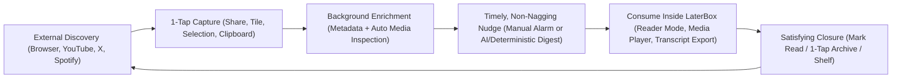

# 04 — Retention & Engagement Strategy (Phases 2.E & 4.3)

## 1. Core Engagement Loop & Natural Repeat-Usage Cadence

LaterBox is a **utility and personal knowledge vault**, not an infinite-scroll social feed. Its natural repeat-usage cadence has two distinct rhythms:
1. **High-Frequency Capture Loop (1–5x/day)**: Triggered externally while browsing Chrome, YouTube, X, TikTok, or Spotify via the Share Sheet (`ShareReceiverActivity`), Text Selection (`ProcessTextActivity`), Floating Selection Pill (`LaterboxSelectionAccessibilityService`), Quick Settings Tile (`QuickSaveTileService`), or Clipboard Suggestion Banner.
2. **Intentional Consumption & Triage Loop (Daily Evening / Weekend)**: Triggered by a scheduled manual reminder, an evening/weekend Smart Digest notification, an offline commute/flight (consuming downloaded video/audio or reading cached articles), or a research session (exporting YouTube transcripts or querying the AI Assistant).

---

## 2. Why Users Currently Abandon LaterBox (Confirmed Codebase Failure Modes)

1. **Silent Failure of Smart Digests Without Gemini API Key or Connectivity**:
   - **Codebase Evidence**: [`SmartReminderWorker.kt`](file:///home/antigravity/Adetisola/Laterbox/app/src/main/java/com/laterbox/app/reminders/smart/SmartReminderWorker.kt#L106-L122) and [`ReminderReceiver.kt`](file:///home/antigravity/Adetisola/Laterbox/app/src/main/java/com/laterbox/app/reminders/ReminderReceiver.kt#L166-L175) both abort notification delivery whenever `SmartDigestEngine.generateDigestCopy()` returns `AiCopyResult.Failure` (`NoApiKey`, `Offline`, `Timeout`, `RateLimited`). Because standard installs do not have a user-configured Gemini API key, Smart Digests **never fire**.
2. **Silent Failure of Manual Reminders on Android 13–15 (`POST_NOTIFICATIONS`)**:
   - **Codebase Evidence**: Setting a reminder in [`SaveLinkForm.kt`](file:///home/antigravity/Adetisola/Laterbox/app/src/main/java/com/laterbox/app/ui/save/SaveLinkForm.kt#L254) or [`SavedItemDetailSheet.kt`](file:///home/antigravity/Adetisola/Laterbox/app/src/main/java/com/laterbox/app/ui/sheets/SavedItemDetailSheet.kt#L303) never requests `Manifest.permission.POST_NOTIFICATIONS`. When the alarm triggers, [`NotificationHelper.kt`](file:///home/antigravity/Adetisola/Laterbox/app/src/main/java/com/laterbox/app/reminders/NotificationHelper.kt#L126) sees the missing permission and drops the notification.
3. **"Read-Later Guilt" & Unfiltered Inbox Accumulation**:
   - Once a user saves 20+ links and reads a few of them, read and unread items remain mixed together in `InboxScreen` unless the user archives each card one by one. There is no `Unread` filter chip and no `"Archive Read Links"` sweep action.

---

## 3. Ethical, High-Signal Retention Improvements

### 3.1 Guarantee 100% Smart Digest Reliability via Deterministic Fallback
- **Grounded in Growth Design Intelligence**: **Video 02 (*Service Recovery Paradox*)** `[04:45]` and **Video 04 (*Duolingo Retention*)** `[06:10]`.
- **Implementation**:
  - Extend [`PlainReminderCopy`](file:///home/antigravity/Adetisola/Laterbox/app/src/main/java/com/laterbox/app/ai/SmartReminderCopy.kt#L62) with `fun forSmartDigest(link: SavedLink, userName: String? = null): SmartReminderCopy`:
    - If `link.personalNote` is present: synthesize a warm reminder incorporating the user's note and domain (e.g., *"Ready for ${link.siteName ?: link.domain}?"* / *"${link.title} — ${link.personalNote}"*).
    - Otherwise, tailor the deterministic copy by `link.contentType` (`VIDEO` → *"Saved video ready to watch"*, `MUSIC` → *"Saved track in your library"*, `ARTICLE`/`WEBSITE` → *"From your reading list"*).
  - Update both [`SmartReminderWorker.kt`](file:///home/antigravity/Adetisola/Laterbox/app/src/main/java/com/laterbox/app/reminders/smart/SmartReminderWorker.kt#L106) and [`ReminderReceiver.kt`](file:///home/antigravity/Adetisola/Laterbox/app/src/main/java/com/laterbox/app/reminders/ReminderReceiver.kt#L166) so that `AiCopyResult.Failure` falls back to `PlainReminderCopy.forSmartDigest(currentLink, prefs.userName)` and delivers the notification reliably.

### 3.2 Contextual Permission Priming at the Moment of Intent
- **Grounded in Growth Design Intelligence**: **Video 04** `[02:15]` and **Video 10** `[05:30]` (ask for permissions only when the user takes an action whose value clearly depends on that permission).
- **Implementation**:
  - When a user taps any reminder preset (`Later today`, `Tonight`, `Tomorrow`, `Weekend`, `Pick time`) in `SaveLinkForm` or `SavedItemDetailSheet`, check `NotificationManagerCompat.from(context).areNotificationsEnabled()`.
  - If `POST_NOTIFICATIONS` is not granted on Android 13+, immediately launch the system permission prompt (`ActivityResultContracts.RequestPermission()`) so the reminder they just set is guaranteed to arrive.
  - If the user previously denied the permission permanently, display an inline actionable banner (`"Notifications are turned off in Android Settings — Enable"`).

### 3.3 Forgiveness Design: No-Shame Backlog Triage ("Clear Read" & "Unread Filter")
- **Grounded in Growth Design Intelligence**: **Video 04 (*Streak Freeze / Forgiveness Design*)** `[06:10]` and **Video 23 (*Habit Formation*)** `[04:10]`.
- **Implementation**:
  - Add an **`Unread`** filter chip at the start of the Inbox filter bar so users can focus purely on unread saves.
  - When `links.count { it.isRead } > 0`, show a 1-tap **`Archive Read (N)`** chip/action that moves all completed links to the Archive with an `"Undo"` Snackbar—giving the user an instant "Inbox Zero / Clean Slate" dopamine reward (**Video 19 (*Peak-End Rule*)** `[03:15]`).

### 3.4 Preserve Anti-Spam Guardrails (What We Explicitly Will NOT Do)
- We will **preserve** the existing 6-hour cooldown and daily cap in [`ContextualNotificationEngine.kt`](file:///home/antigravity/Adetisola/Laterbox/app/src/main/java/com/laterbox/app/reminders/ContextualNotificationEngine.kt#L288-L291) and the `ReminderPersistence` (`GENTLE = 2`, `BALANCED = 3`, `PERSISTENT = 5`) nudge ceiling in [`SmartReminderModels.kt`](file:///home/antigravity/Adetisola/Laterbox/app/src/main/java/com/laterbox/app/reminders/smart/SmartReminderModels.kt).
- We will **never** introduce artificial streaks, guilt-inducing push notifications, or fake unread badges. Every notification must correspond to a real user-saved item or an actionable background task (e.g., finished media download).
