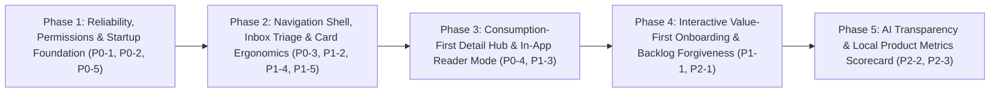

# 06 — Prioritised Implementation Roadmap (Phase 4.7)

The overhaul is structured into **5 logical, independently testable phases**. Foundational reliability, architectural performance, and core navigation/UX improvements are prioritized ahead of new feature capabilities and polish.

---

## Phase 1: Reliability, Permissions & Startup Foundation (`P0-1`, `P0-2`, `P0-5`)

### Objectives
Eliminate silent reminder/digest failures, wire contextual `POST_NOTIFICATIONS` permission priming, share `OkHttpClient` pools, and stage cold-startup background tasks so Share/QuickSave sheets open instantaneously.

### Files & Areas Affected
- [`SmartReminderCopy.kt`](file:///home/antigravity/Adetisola/Laterbox/app/src/main/java/com/laterbox/app/ai/SmartReminderCopy.kt) — Add `PlainReminderCopy.forSmartDigest(link, userName)`.
- [`SmartReminderWorker.kt`](file:///home/antigravity/Adetisola/Laterbox/app/src/main/java/com/laterbox/app/reminders/smart/SmartReminderWorker.kt) & [`ReminderReceiver.kt`](file:///home/antigravity/Adetisola/Laterbox/app/src/main/java/com/laterbox/app/reminders/ReminderReceiver.kt) — Deliver deterministic fallback notification when `SmartDigestEngine.generateDigestCopy()` returns `AiCopyResult.Failure`.
- `ui/util/NotificationPermissionHelper.kt` *(New)*, [`SaveLinkForm.kt`](file:///home/antigravity/Adetisola/Laterbox/app/src/main/java/com/laterbox/app/ui/save/SaveLinkForm.kt), [`SavedItemDetailSheet.kt`](file:///home/antigravity/Adetisola/Laterbox/app/src/main/java/com/laterbox/app/ui/sheets/SavedItemDetailSheet.kt), [`RemindersAiSettingsScreen.kt`](file:///home/antigravity/Adetisola/Laterbox/app/src/main/java/com/laterbox/app/ui/settings/RemindersAiSettingsScreen.kt) — Prompt for `POST_NOTIFICATIONS` on Android 13+ when scheduling reminders or enabling Smart Reminders.
- [`LaterboxApplication.kt`](file:///home/antigravity/Adetisola/Laterbox/app/src/main/java/com/laterbox/app/LaterboxApplication.kt) & [`AppContainer.kt`](file:///home/antigravity/Adetisola/Laterbox/app/src/main/java/com/laterbox/app/di/AppContainer.kt) — Deduplicate `reconcileInspections()`, defer heavy `yt-dlp`/`FFmpeg`/orphan-sweep tasks behind a post-startup delay, and share a single `OkHttpClient` instance across adapters.
- [`SavedLinkDao.kt`](file:///home/antigravity/Adetisola/Laterbox/app/src/main/java/com/laterbox/app/data/local/dao/SavedLinkDao.kt), [`ArchiveViewModel.kt`](file:///home/antigravity/Adetisola/Laterbox/app/src/main/java/com/laterbox/app/ui/archive/ArchiveViewModel.kt), [`BackupManager.kt`](file:///home/antigravity/Adetisola/Laterbox/app/src/main/java/com/laterbox/app/data/backup/BackupManager.kt) — Fix search query parity (`description`, `site_name`, `originalUrl`) and preserve `reminderAt` in JSON backups.

### Dependencies
- None (foundational phase).

### Acceptance Criteria & Verification
- Unit tests in `SmartDigestTest.kt` verify that `PlainReminderCopy.forSmartDigest` produces personalized, content-type-appropriate copy when `NoApiKey` or `Offline` occurs, and that `SmartReminderWorker`/`ReminderReceiver` deliver the notification instead of skipping the slot.
- `LaterboxDatabaseTest.kt` and `BackupManagerTest.kt` verify `description`/`site_name` search matching and `reminderAt` JSON round-trip preservation.

---

## Phase 2: Navigation Shell, Inbox Triage & Card Ergonomics (`P0-3`, `P1-2`, `P1-4`, `P1-5`)

### Objectives
Restore 1-handed ergonomics on handsets by activating `LaterboxBottomBar`, replacing the intrusive full-width `FloatingChatComposer` with a compact contextual Action Dock, adding Inbox status/type filters (`Unread`, `Offline Media`, `Scheduled`, `Videos`), and unifying `SavedLinkCard` capabilities across Inbox, Collections, and Archive.

### Files & Areas Affected
- [`LaterboxNavGraph.kt`](file:///home/antigravity/Adetisola/Laterbox/app/src/main/java/com/laterbox/app/ui/navigation/LaterboxNavGraph.kt) & [`LaterboxBottomBar.kt`](file:///home/antigravity/Adetisola/Laterbox/app/src/main/java/com/laterbox/app/ui/components/LaterboxBottomBar.kt) — Wire `LaterboxBottomBar` (`Inbox`, `Collections`, `Downloads`, `Archive`) into the handset layout; scope secondary ViewModel state collection to active destinations.
- [`InboxScreen.kt`](file:///home/antigravity/Adetisola/Laterbox/app/src/main/java/com/laterbox/app/ui/inbox/InboxScreen.kt), [`InboxUiState.kt`](file:///home/antigravity/Adetisola/Laterbox/app/src/main/java/com/laterbox/app/ui/inbox/InboxUiState.kt), [`InboxViewModel.kt`](file:///home/antigravity/Adetisola/Laterbox/app/src/main/java/com/laterbox/app/ui/inbox/InboxViewModel.kt) — Add `InboxQuickFilter` (`ALL`, `UNREAD`, `MEDIA_READY`, `REMINDERS`, `VIDEOS`), `"Archive Read (N)"` quick-sweep action with Undo, cycle `CARD -> COMPACT -> EDITORIAL` view modes, and replace the permanently expanded bottom chat bar with a compact `[✨ Ask Assistant] [+ Save]` dock (or expandable composer).
- [`SavedLinkCard.kt`](file:///home/antigravity/Adetisola/Laterbox/app/src/main/java/com/laterbox/app/ui/components/SavedLinkCard.kt), [`CollectionDetailScreen.kt`](file:///home/antigravity/Adetisola/Laterbox/app/src/main/java/com/laterbox/app/ui/collections/CollectionDetailScreen.kt), [`ArchiveScreen.kt`](file:///home/antigravity/Adetisola/Laterbox/app/src/main/java/com/laterbox/app/ui/archive/ArchiveScreen.kt) — Enlarge `"View ↗"` touch target, render `+N` badge for multi-collection links, and enable swipe actions + media-ready badges in `CollectionDetailScreen`.

### Dependencies
- Phase 1 DAO updates.

### Acceptance Criteria & Verification
- `InboxViewModelTest.kt` and `InboxUiAndChatFlowTest.kt` pass and cover `InboxQuickFilter` filtering (`UNREAD`, `MEDIA_READY`, `REMINDERS`, `VIDEOS`), `EDITORIAL` view mode cycling, bottom navigation switching, and `"Archive Read"` batch action + Undo.

---

## Phase 3: Consumption-First Detail Hub & In-App Reader Mode (`P0-4`, `P1-3`)

### Objectives
Transform `SavedItemDetailSheet` from a raw text-field edit form into a **Consumption-First Hub** where reading, playing offline media, and extracting YouTube transcripts sit above the fold, and introduce an on-device **Distraction-Free Article Reader (`ArticleReaderSheet`)**.

### Files & Areas Affected
- [`SavedItemDetailSheet.kt`](file:///home/antigravity/Adetisola/Laterbox/app/src/main/java/com/laterbox/app/ui/sheets/SavedItemDetailSheet.kt) & [`SavedItemDetailViewModel.kt`](file:///home/antigravity/Adetisola/Laterbox/app/src/main/java/com/laterbox/app/ui/sheets/SavedItemDetailViewModel.kt) — Present read-only editorial title, description, personal note quote card, and primary consumption CTAs (`Read Article`, `Open Link ↗`, `Play Media`) at the top; toggle inline `OutlinedTextField` editing via an `"Edit"` button; hoist `YouTubeTranscriptDetailCard` and `MediaSection` above the fold.
- `data/reader/ArticleContentExtractor.kt` *(New)* & `ui/reader/ArticleReaderSheet.kt` *(New)* — Extract clean article body blocks (headings, paragraphs, quotes, code blocks, lead image, reading time estimate) using `Jsoup`, cache locally in `context.cacheDir/reader_cache/`, and render in a calm, distraction-free Compose sheet honoring `LaterboxTheme` and `fontSizeScale`.
- [`ReadingBehaviorSettingsScreen.kt`](file:///home/antigravity/Adetisola/Laterbox/app/src/main/java/com/laterbox/app/ui/settings/ReadingBehaviorSettingsScreen.kt) — Add preferences for Default Card Tap Behavior and Default View Mode (`Card`, `Compact`, `Editorial`).

### Dependencies
- Phase 2 navigation & card updates.

### Acceptance Criteria & Verification
- Unit tests for `ArticleContentExtractorTest.kt` verifying clean HTML-to-blocks extraction, script/ad stripping, reading time calculation, and graceful fallback when a page is paywalled or non-article.
- UI tests verifying `SavedItemDetailSheet` consumption-first layout and inline edit toggle.

---

## Phase 4: Interactive Value-First Onboarding & First-Win Experience (`P1-1`, `P2-1`)

### Objectives
Replace the passive 3-slide text onboarding modal with an interactive `<45-second` onboarding experience that communicates LaterBox's full value proposition, seeds an optional interactive showcase link (or saves the user's current clipboard URL in 1 tap), and primes notification permissions.

### Files & Areas Affected
- [`OnboardingSheet.kt`](file:///home/antigravity/Adetisola/Laterbox/app/src/main/java/com/laterbox/app/ui/onboarding/OnboardingSheet.kt) & [`InboxViewModel.kt`](file:///home/antigravity/Adetisola/Laterbox/app/src/main/java/com/laterbox/app/ui/inbox/InboxViewModel.kt) — Redesigned interactive onboarding with starter link seed toggle, clipboard quick-save integration, and 1-tap `POST_NOTIFICATIONS` + Quick Settings Tile setup.
- [`InboxScreen.kt`](file:///home/antigravity/Adetisola/Laterbox/app/src/main/java/com/laterbox/app/ui/inbox/InboxScreen.kt) — Upgrade the empty Inbox state with a secondary `"Load a Sample Link"` action so users never get stuck on a blank canvas.
- [`README.md`](file:///home/antigravity/Adetisola/Laterbox/README.md) — Update product documentation to accurately reflect LaterBox's complete capabilities.

### Dependencies
- Phase 1 (`NotificationPermissionHelper`) and Phase 3 (`SavedItemDetailSheet` & `ArticleReaderSheet`).

### Acceptance Criteria & Verification
- Unit and Compose UI tests verifying onboarding completion with starter link seeding, clipboard save from onboarding, and empty-state sample link trigger.

---

## Phase 5: AI Transparency & Local Product Metrics Scorecard (`P2-2`, `P2-3`)

### Objectives
Enhance user trust in AI interactions with clear context indicators and add a 100% local, privacy-preserving Product & Library Metrics Scorecard in Settings.

### Files & Areas Affected
- [`ChatScreen.kt`](file:///home/antigravity/Adetisola/Laterbox/app/src/main/java/com/laterbox/app/ui/chat/ChatScreen.kt) & [`LaterboxContextEngine.kt`](file:///home/antigravity/Adetisola/Laterbox/app/src/main/java/com/laterbox/app/ai/LaterboxContextEngine.kt) — Display a transparent `"Local Library Context Active"` badge and avoid attaching full link dumps on trivial greetings if unnecessary.
- `diagnostics/ProductMetricsTracker.kt` *(New)* & [`SettingsScreen.kt`](file:///home/antigravity/Adetisola/Laterbox/app/src/main/java/com/laterbox/app/ui/settings/SettingsScreen.kt) — Track local activation, capture source distribution, consumption ratio, and reminder effectiveness without any external tracking SDKs.

### Dependencies
- Phases 1–4.

### Acceptance Criteria & Verification
- Unit tests verifying `ProductMetricsTracker` calculations and privacy-safe diagnostic summary formatting.
- Full test suite (`./gradlew testDebugUnitTest`) and debug APK assemble (`./gradlew assembleDebug`) passing with 0 regressions.
